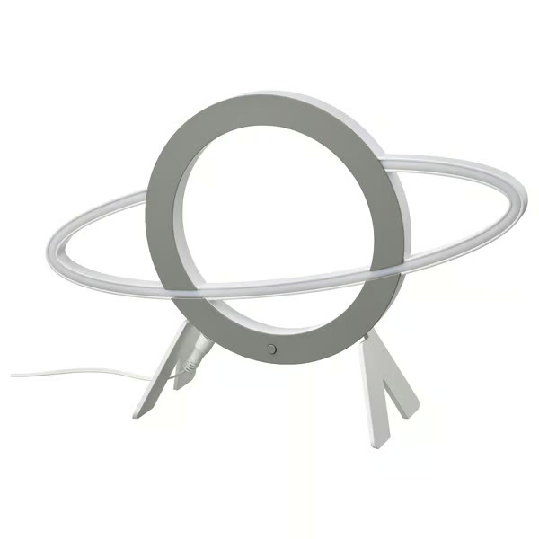
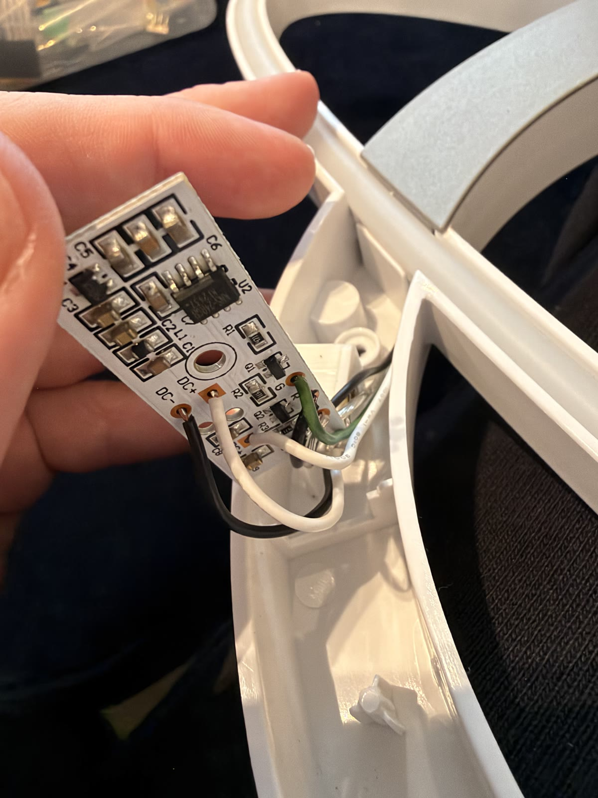
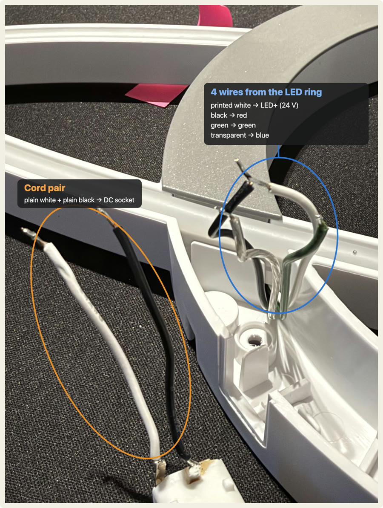
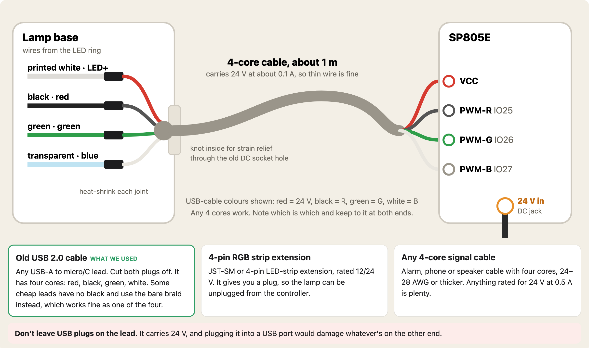
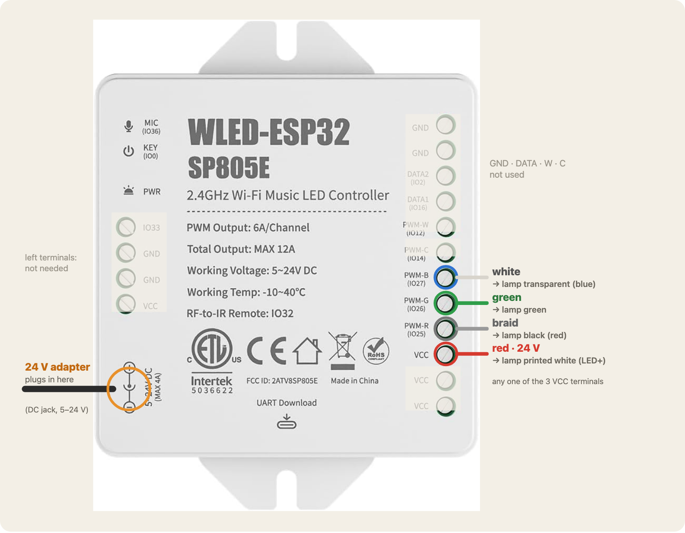

# IKEA AFTONSPARV planet lamp → WLED



*The IKEA AFTONSPARV planet lamp. Photo: IKEA.*

Swap the IKEA controller in the [AFTONSPARV planet lamp](https://www.ikea.com/gb/en/p/aftonsparv-led-decoration-lighting-planet-shape-multicolour-10558776/) (art. 105.587.76) for an off-the-shelf WLED controller. You get full RGB, Wi-Fi, the WLED app and Home Assistant control. It takes about an hour with a soldering iron, and you don't need to build any electronics.

The lamp's LEDs are **analog RGB, common anode, at 24 V**, so not addressable. Any controller you use must have **PWM RGB outputs**. Most cheap "WLED controller" listings are for addressable (WS2812) strips and won't drive this lamp.

## Parts

| Part | Notes |
|---|---|
| **BTF-LIGHTING SP805E** WLED controller ([Amazon UK B0H3V5T62D](https://www.amazon.co.uk/dp/B0H3V5T62D), about £35) | ESP32 with WLED preinstalled. PWM R/G/B/W/C outputs, 5–24 V in, reverse-polarity protected |
| 24 V DC adapter, 1 A or more, with a barrel plug that fits the SP805E jack | The IKEA brick is only 3 W, which leaves too little headroom once the ESP32 is drawing power too |
| 4-core cable, about 1 m | Any thin 4-core works. We used a cut USB cable, hardwired with no plugs. A 4-pin RGB strip extension (JST-SM) makes it detachable |
| Soldering iron, heat-shrink or PVC tape, multimeter | |

**Alternatives:** the GLEDOPTO ESP32 PWM WLED controller ([B0DP9H9WCL](https://www.amazon.co.uk/dp/B0DP9H9WCL)) also works, but it ships from a third party and is slower to arrive. Avoid these:
- GL-C-017WL-D (digital only)
- Elite 1D2P (only two PWM channels)
- GL-C-208M (Matter firmware, not WLED)

## 1. Open the lamp and free the wires

1. Unplug the lamp. Take off the bottom cover; one screw is hidden under the sticker.
2. Photograph the IKEA board (marked **HE-QPDRGB-05**) before desoldering anything.

   

3. Desolder all six wires from the board. Four come from the LED ring, and two go to the DC socket:

| Wire | Function | Board pad |
|---|---|---|
| White **with printed text** on the insulation | LED + (24 V common anode) | DC+ (the one by C8) |
| Black (from the ring) | Red, low side | R |
| Green | Green, low side | G |
| Transparent | Blue, low side | B |
| Plain white + plain black (twisted pair) | Cord to the DC socket | DC+ / DC− |

> ⚠️ Both whites sit on DC+, and the printed text is the only thing that tells them apart. Flag the LED+ wire before you desolder it.



You can throw away the IKEA board. The DC socket lifts out of its slot, which leaves a hole you can route the new cable through.

## 2. Run a 4-core lead out of the lamp

Solder the 4-core cable onto the four ring wires and insulate each joint separately. Feed the cable out through the old DC socket hole and tie a knot inside for strain relief. Write down which core goes to which wire.



The SP805E is too big to fit inside the lamp base, so it sits on the cable outside. That also helps its Wi-Fi.

## 3. Wire the SP805E



| SP805E terminal | Lamp wire | WLED GPIO |
|---|---|---|
| **VCC** (any of the three) | printed white (LED+) | n/a |
| **PWM-R** | black | 25 |
| **PWM-G** | green | 26 |
| **PWM-B** | transparent | 27 |

Power goes into the **DC jack only**. Leave the other GND, DATA, PWM-W/C and left-hand terminals empty.

## 4. Set up WLED

Plug in the 24 V adapter, then join the controller to your Wi-Fi: connect to its `WLED-AP` network, or use [install.wled.me](https://install.wled.me) → Connect → Change Wi-Fi over USB.

**The lamp will stay dark at first. That's expected.** The SP805E ships configured for addressable strips (two WS281x outputs on IO16 and IO2, with an 850 mA limiter). Change these settings in **Config → LED Preferences**:

- Delete both LED outputs. Add one output of type **PWM RGB** on pins **25, 26, 27**, with length **1**.
- **Brightness limiter:** off.
- **PWM frequency:** about 19.5 kHz.

Then in **Config → LED Preferences → Color gamma correction**, tick **gamma correct colour**.

> Why the gamma setting matters: BTF ships it off. The green LED is very efficient, so Home Assistant's red (255, 38, 0) comes out **orange** without gamma. With gamma on, it's a strong red.

Or do it all over the API in one go (replace the IP with your controller's):

```bash
IP=192.168.0.84
curl -X POST http://$IP/json/cfg -H 'Content-Type: application/json' -d '{
  "hw":{"led":{"total":1,"maxpwr":0,"ins":[{"start":0,"len":1,"pin":[25,26,27],"order":0,"type":43,"freq":19531,"maxpwr":0,"ledma":0}]}},
  "light":{"gc":{"bri":1,"col":2.8,"val":2.8}}
}'
```

On WLED 0.15 these settings apply live, so you don't need to reboot. In WLED's config JSON, `gc.col: 1` means gamma is **off** and `2.8` means **on**.

### Power-on colour

Set the colour you want, then save it as a preset and make it the boot preset. In the UI that's Presets → save, then Config → LEDs → "Apply preset at boot". Over the API:

```bash
curl -X POST http://$IP/json/state -H 'Content-Type: application/json' -d '{"psave":1,"n":"Default","ib":true,"sb":true}'
curl -X POST http://$IP/json/cfg   -H 'Content-Type: application/json' -d '{"def":{"ps":1,"on":true,"bri":255}}'
```

### Home Assistant

The WLED integration discovers the controller automatically. Make sure colour gamma is on first (see above), or HA's colours won't match.

## 5. Test it

`tools/lamp-test.mjs` checks the config, cycles through ten colours plus a dimming ramp, and runs a 20 s full-white power test (it fails if the controller reboots). It needs Node 18+ and nothing else.

```bash
node tools/lamp-test.mjs 192.168.0.84 --no-camera                      # you watch the lamp
node tools/lamp-test.mjs 192.168.0.84 --camera "MacBook Pro Camera"    # the webcam checks each colour (needs ffmpeg)
```

It writes an HTML report to `tools/reports/`. On macOS the terminal app needs Camera permission. Apps that can't ask for it, such as some IDE terminals, are blocked silently, so run it from Terminal.app.

## More

- [`LESSONS.md`](LESSONS.md): what we learnt, including from the hand-built ESP32-C3 version this replaced.
- [`PLAN.md`](PLAN.md): the full build log and notes for the Govee light-bars project.
- [`guide/`](guide/): step-by-step HTML pages from the DIY build. Open `guide/index.html` in a browser.
- Open-hardware drop-in board for the same lamp: [caffeinated-labs/Caffeinated-AFTONSPARV](https://github.com/caffeinated-labs/Caffeinated-AFTONSPARV).
